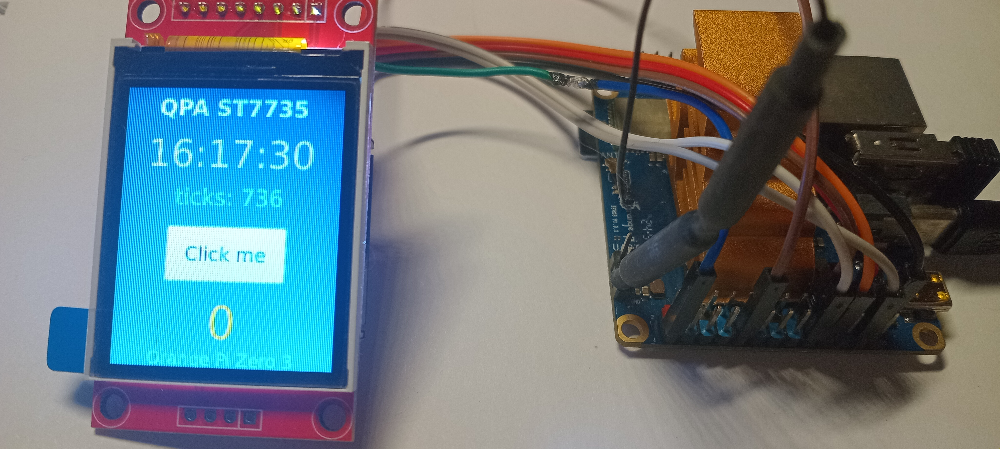

# QPA_ST7735

Two components in one repository:

- **`src/`** — a Qt 6 QPA platform plugin (`qpast7735`) that renders Qt
  applications directly on an ST7735 SPI display (128x160, RGB565);
- **`lib/`** — a small dependency-free display driver library that can be
  used on its own, without Qt, to init the panel, fill it and blit
  rectangles.

Developed and tested on **Orange Pi Zero 3** (H618, Ubuntu 24.04,
Qt 6.4). The library talks to the hardware through plain Linux system
calls only: `spidev` ioctls for SPI and sysfs GPIO for the DC/CS/RST
lines. No WiringOP, no libgpiod, no OpenGL.



*The reference setup: 1.8" ST7735S 128x160 on an Orange Pi Zero 3,
running a Qt Quick scene through the plugin.*

## Repository layout

```
QPA_ST7735/
├── lib/                    display driver library (no Qt dependency)
│   ├── hal/                SpidevBus (spidev), SysfsGpioLine (sysfs GPIO)
│   ├── display/            St7735Driver: init, fill, blit
│   └── example/            st7735-example: draws colored squares at 32 MHz
├── scripts/setup-permissions.sh  udev rules + input group (no root needed)
├── src/                    QPA plugin "qpast7735"
│   ├── Plugin/             plugin entry point + metadata.json
│   ├── Platform/           Integration, Screen, Window, Cursor, BackingStore
│   ├── Input/              MouseDevice, KeyboardDevice: evdev input
│   └── Config/             JSON / environment configuration
├── config/qpa_st7735.json  default configuration for Orange Pi Zero 3
├── docs/real.jpg           photo of the reference setup
└── qml-app/                QML demo (clock, text input, scroll view, button)
```

## Wiring (Orange Pi Zero 3, 26-pin header)

| Display pin | Board pin | Signal  | GPIO line |
|-------------|-----------|---------|-----------|
| VCC         | 1 or 17   | 3.3V    | -         |
| GND         | 6/9/14/20/25 | GND  | -         |
| SCL (SCK)   | 23        | SPI1 SCLK (PH6) | - (spidev) |
| SDA (MOSI)  | 19        | SPI1 MOSI (PH7) | - (spidev) |
| CS          | 26        | PC10    | 74        |
| DC (A0)     | 22        | PC7     | 71        |
| RESET       | 18        | PC14    | 78        |

GPIO lines are addressed through libgpiod. SPI must be enabled with a
spidev overlay so that `/dev/spidev1.1` exists (Orange Pi:
`overlays=spi1-cs1-spidev` in `/boot/orangepiEnv.txt`).

## Finding GPIO lines on your board

GPIO is addressed through libgpiod (`/dev/gpiochip*`). Each of `cs`,
`dc`, `rst` in the config accepts three forms:

- a **number** — line offset, used only if exactly one chip has it
  (e.g. `"74"`: on the Zero 3 gpiochip0 is the only chip with 288
  lines, so 74 unambiguously means PC10);
- a **line name** from `gpioinfo` (e.g. `"PC10"` on Allwinner,
  `"GPIO1_B2"` on Rockchip) — searched across all chips;
- an explicit **`"chip:line"`** (e.g. `"gpiochip0:22"` on
  Raspberry Pi 5, where offsets are the BCM GPIO numbers) — the most
  predictable form.

How to find your lines:

    gpioinfo                       # chips, line counts, names
    gpiofind PC10                  # where does this name live
    gpiodetect                     # list chips

**Orange Pi Zero 3 (H618).** One 288-line chip, ports are 32 lines
wide: `PC10 -> (2) * 32 + 10 = 74`, `PC7 -> 71`, `PC14 -> 78` (the
number form works because the second chip has only 32 lines).

**Raspberry Pi 5.** Single `gpiochip0`, line offsets are the BCM GPIO
numbers: use `"gpiochip0:17"` style entries (or bare `"17"`, which is
unique). The legacy /sys/class/gpio does not exist on this board.

**Orange Pi 5 (RK3588) and other Rockchip boards.** Several gpiochips;
prefer line names (`gpioinfo` shows names like `GPIO1_B2`) or explicit
`"gpiochipN:MM"`. Bare numbers are ambiguous there and the plugin will
refuse them with the list of matching chips.

Line names and offsets can change between kernels and device-tree
overlays; re-check after a board or kernel update.

## Requirements

For the display library alone (`lib/`) nothing beyond a C++17 compiler
and CMake is needed.

On the target board, for the plugin and the demo:

    sudo apt install build-essential cmake libgpiod-dev \
        qt6-base-dev qt6-base-private-dev qt6-base-dev-tools

For the QML demo additionally:

    sudo apt install qt6-declarative-dev \
        qml6-module-qtquick qml6-module-qtquick-window \
        qml6-module-qtquick-controls qml6-module-qtquick-templates

## Build

Build everything (library + example + plugin + QML demo) on the board:

    cmake -B build -S .
    cmake --build build -j$(nproc)

Outputs:

- `build/lib/example/st7735-example` — standalone library demo
- `build/src/libqpast7735.so` — the QPA plugin

### Building only the display library

The library has no Qt dependency and builds on its own — useful for
plain C++ projects that just want to draw on the panel:

    cmake -B build-lib -S lib
    cmake --build build-lib -j$(nproc)

Output: `build-lib/example/st7735-example` (colored squares demo).

## Install the plugin

For distro-packaged Qt the plugin must go into the system platforms
directory; `--prefix /usr` is required (the default `/usr/local` prefix
is not scanned by Qt):

    sudo cmake --install build --prefix /usr

This installs:

- `/usr/lib/<arch>/qt6/plugins/platforms/libqpast7735.so`
- `/usr/share/qpa_st7735/examples/qpa_st7735.json` — sample config

Alternatively skip installation and point Qt at the build directory:

    export QT_QPA_PLATFORM_PLUGIN_PATH=$PWD/build/src

## Running applications

After installing the plugin run once as root:

    sudo sh scripts/setup-permissions.sh

It installs a udev rule that opens `/dev/spidev*` and `/dev/gpiochip*`
(mode 0666) and adds your user to the `input` group for the mouse and
keyboard (takes effect after the next login). Applications then run
without root:

    QT_QPA_PLATFORM=qpast7735 ./your-app

Until the script is run, `sudo` is still required for spidev/GPIO.

Widgets and raster windows work out of the box. Qt Quick (QML) needs
the software renderer because the plugin provides no OpenGL context:

    sudo env QT_QPA_PLATFORM=qpast7735 QT_QUICK_BACKEND=software ./your-qml-app

### QML demo

    g++ -std=c++17 -O2 qml-app/main.cpp -o /tmp/qml-demo \
        $(pkg-config --cflags --libs Qt6Quick Qt6Qml Qt6Gui)
    sudo install -D qml-app/Main.qml /usr/local/share/qpast7735/Main.qml
    sudo env QT_QPA_PLATFORM=qpast7735 QT_QUICK_BACKEND=software /tmp/qml-demo

## Using the display library directly

Without any Qt, link against the `st7735` static library (or just add
the six files of `lib/hal` and `lib/display` to your project):

```cpp
#include "SpidevBus.hpp"
#include "SysfsGpioLine.hpp"
#include "St7735Driver.hpp"

SpidevBus bus("/dev/spidev1.1");
SysfsGpioLine chipSelect(74);   // PC10
SysfsGpioLine dataCommand(71);  // PC7
SysfsGpioLine reset(78);        // PC14

St7735Driver::Config config{128, 160, 1'000'000, 32'000'000};
St7735Driver driver(bus, chipSelect, dataCommand, reset, config);
driver.initialize();
driver.fill(0xF800);  // red

// partial update: pixels are RGB565 in native uint16_t order,
// stride is the row pitch of the source buffer in bytes
std::vector<std::uint16_t> patch(40 * 40, 0x07E0);
driver.blit(10, 10, 40, 40, patch.data(), 40 * sizeof(std::uint16_t));
```

`lib/example/main.cpp` is a complete runnable demo: it clears the panel
and draws colored squares one by one in different screen regions.

## Configuration

The plugin looks for a JSON file in this order (first existing wins):

1. path from `$QPA_ST7735_CONFIG`
2. `./qpa_st7735.json` in the working directory
3. `/etc/qpa_st7735.json` and `/usr/local/etc/qpa_st7735.json`
4. `/usr/share/qpa_st7735/qpa_st7735.json` — installed by
   `cmake --install`, so a board-specific config needs no recompiling
5. built-in defaults (Orange Pi Zero 3, 32 MHz data speed)

To move the plugin to another board, edit the installed
`/usr/share/qpa_st7735/qpa_st7735.json` (or copy it to `/etc/`): GPIO
lines, spidev device and panel parameters are all there.

```json
{
    "spi":   { "device": "/dev/spidev1.1", "speed": 32000000 },
    "gpio":  { "cs": 74, "dc": 71, "rst": 78 },
    "panel": { "width": 128, "height": 160, "initSpeedHz": 1000000 },
    "fonts": { "dir": "/usr/share/fonts/truetype/dejavu" },
    "mouse": { "enabled": true, "showCursor": true, "device": "auto" }
}
```

Environment variables override JSON (handy for quick experiments):

| Variable          | Effect                                    |
|-------------------|-------------------------------------------|
| `QT_SPI_DEV`      | spidev device path                        |
| `QT_SPI_SPEED`    | data transfer speed, Hz                   |
| `QT_SPI_GPIO_CS`  | chip-select line: number, name or `chip:line` |
| `QT_SPI_GPIO_DC`  | data/command line: number, name or `chip:line` |
| `QT_SPI_GPIO_RST` | reset line: number, name or `chip:line`   |
| `QT_MOUSE_DEV`    | mouse evdev device, e.g. `/dev/input/event3` |

Notes on speeds: single commands (init sequence) are always sent at
1 MHz — the panel does not accept them at higher rates on this setup.
Pixel data runs at `spi.speed`; 32 MHz is stable on short wires, drop
it if you see artifacts.

## Mouse input

A USB mouse works out of the box: the plugin reads it directly from
evdev (`/dev/input/event*`), delivers left/right/middle clicks and the
wheel to the application like any other QPA plugin, and draws a
software cursor on top of each frame (the panel has no hardware
overlay). The cursor tip is clamped to the screen bounds, exactly like
on a desktop. Reading `/dev/input` requires root — the same `sudo` the
display already needs.

The mouse device is autodetected (first evdev node with "mouse" in its
name); pin it explicitly via `QT_MOUSE_DEV` or the JSON `mouse.device`.
Without a mouse the plugin keeps working, and the cursor stays hidden
until the first mouse event. Only `ArrowCursor` and `BlankCursor`
shapes are honored — there is no cursor theme on the panel, everything
else renders as the arrow.

Mouse options in the JSON config:

```json
"mouse": { "enabled": true, "showCursor": true, "device": "auto" }
```

| Key          | Default | Effect                                              |
|--------------|---------|-----------------------------------------------------|
| `enabled`    | `true`  | `false` disables the mouse completely: no device is opened, no events are delivered |
| `showCursor` | `true`  | `false` hides the software cursor; clicks and the wheel keep working |
| `device`     | `"auto"`| explicit evdev node, e.g. `/dev/input/event3`       |

Cursor movement is decoupled from input processing: mouse events are
delivered to the application immediately, while panel updates with the
new cursor position are coalesced to at most ~30 per second.

## Keyboard input

A USB keyboard works the same way: the plugin reads it from evdev and
delivers key presses/releases (with Shift/Ctrl/Alt/Meta modifiers,
Caps Lock and autorepeat) via `QWindowSystemInterface::handleKeyEvent`,
exactly like other QPA plugins. The US layout is generated internally —
printable keys produce text, navigation and function keys send their
Qt key codes. The device is autodetected (name with "keyboard", or a
node that has KEY_Q/KEY_SPACE and no BTN_LEFT); options in the JSON
config:

```json
"keyboard": { "enabled": true, "device": "auto" }
```

## Troubleshooting

- **White screen**: check wiring (CS/DC/RST), check `ls /dev/spidev*`.
- **Garbage on the panel**: the DC/CS/RST lines resolve to the wrong
  GPIO (typical on multi-chip boards like Orange Pi 5) — check the
  `gpio: линия ... не запросилась` messages and pin the lines with the
  explicit `"gpiochipN:MM"` form.
- **Only the first frame renders**: the DC level must be re-asserted
  before every scan line (the library does this); re-check the DC wire.
  If the SPI controller suspends between rare updates, its state is
  visible in
  `cat /sys/class/spi_master/spi1/device/power/runtime_status`.
- **No Qt logs on the console**: add `QT_FORCE_STDERR_LOGGING=1`.
- **Plugin not found**: `QT_QPA_PLATFORM_PLUGIN_PATH` must point to the
  directory that contains `libqpast7735.so` directly.
- **QML shows "This plugin does not support createPlatformOpenGLContext"**:
  `QT_QUICK_BACKEND=software` is missing.
- **Mouse does not move / no clicks**: run as root (`/dev/input/event*`
  are root-only), check the device picked in the log
  (`qpast7735: mouse: ...`), try `QT_MOUSE_DEV=/dev/input/eventN`.

## Limitations

- Raster rendering only, no OpenGL, no vsync.
- Mouse and keyboard only: no touch input.
- Keyboard text is US-layout only.
- Every window is stretched to the full 128x160 screen.
- Each `flush()` sends a full frame (about 10 ms at 32 MHz); partial
  dirty regions are not used because Qt Quick incremental updates
  leave artifacts on this panel.

## Hardware notes baked into the library

These behaviors were verified on the target and are part of `lib/`:

- CS is pulled low once per session and held; the kernel chip-select is
  not used (the CS pin of the display is a regular sysfs GPIO).
- The DC level is re-asserted before every scan line; without this the
  panel drops the stream after the first frame.
- GPIO lines are released cleanly on exit (libgpiod owns them while
  the process runs); stale `/sys/class/gpio` exports from old versions
  block gpiod with EBUSY — remove them with
  `echo 71 | sudo tee /sys/class/gpio/unexport`.
