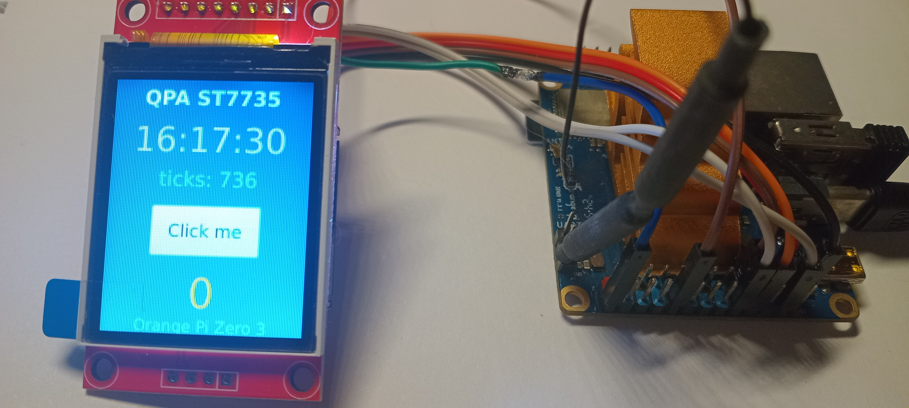

# QPA_ST7735

Two components in one repository:

- **`src/`** — a Qt 6 QPA platform plugin (`qpast7735`) that renders Qt
  applications directly on an ST7735 SPI display (128x160, RGB565);
- **`lib/`** — a small dependency-free display driver library that can be
  used on its own, without Qt, to init the panel, fill it and blit
  rectangles.

Developed and tested on **Orange Pi Zero 3** (H618, Ubuntu 24.04,
Qt 6.4). The library talks to the hardware through plain Linux system
calls only: `spidev` ioctls for SPI and sysfs GPIO for the DC/CS/RST
lines. No WiringOP, no libgpiod, no OpenGL.



*The reference setup: 1.8" ST7735S 128x160 on an Orange Pi Zero 3,
running a Qt Quick scene through the plugin.*

## Repository layout

```
QPA_ST7735/
├── lib/                    display driver library (no Qt dependency)
│   ├── hal/                SpidevBus (spidev), SysfsGpioLine (sysfs GPIO)
│   ├── display/            St7735Driver: init, fill, blit
│   └── example/            st7735-example: draws colored squares at 32 MHz
├── src/                    QPA plugin "qpast7735"
│   ├── Plugin/             plugin entry point + metadata.json
│   ├── Platform/           Integration, Screen, Window, Cursor, BackingStore
│   ├── Input/              MouseDevice: evdev mouse, software cursor input
│   └── Config/             JSON / environment configuration
├── config/qpa_st7735.json  default configuration for Orange Pi Zero 3
├── docs/real.jpg           photo of the reference setup
└── qml-app/                QML demo (clock, text input, scroll view, button)
```

## Wiring (Orange Pi Zero 3, 26-pin header)

| Display pin | Board pin | Signal  | sysfs GPIO |
|-------------|-----------|---------|------------|
| VCC         | 1 or 17   | 3.3V    | -          |
| GND         | 6/9/14/20/25 | GND  | -          |
| SCL (SCK)   | 23        | SPI1 SCLK (PH6) | - (spidev) |
| SDA (MOSI)  | 19        | SPI1 MOSI (PH7) | - (spidev) |
| CS          | 26        | PC10    | 74         |
| DC (A0)     | 22        | PC7     | 71         |
| RESET       | 18        | PC14    | 78         |

GPIO numbers are global kernel line numbers (the "GPIO" column of
`gpio readall`). SPI must be enabled with a spidev overlay so that
`/dev/spidev1.1` exists (Armbian: `overlays=spi-spidev` in
`/boot/armbianEnv.txt`).

## Finding GPIO numbers on your board

GPIO numbering differs between boards and SoCs. The numbers used in
the JSON config and in the wiring table above are **global kernel line
numbers**, not physical header pins and not WiringPi/wPi numbers. Use
one of the following ways to find them for your board.

**Allwinner formula (H3/H6/H616/H618...).** Pins are named like PC7:
port letter C, pin 7 inside the port. The global number is
`(letter - 'A') * 32 + pin`, i.e. ports are 32 lines wide:

    PC7  -> (3 - 1) * 32 + 7  = 71
    PC10 -> (3 - 1) * 32 + 10 = 74
    PC14 -> (3 - 1) * 32 + 14 = 78

**gpioinfo (libgpiod, available on most distros).** Lists every line
with its name; the number in front is what goes into the config:

    gpioinfo | grep -i "PC7"

**gpio readall (WiringOP).** The "GPIO" column (not "wPi", not
"Physical") contains the same global numbers. On the Orange Pi Zero 3:

    +------+-----+----------+--------+---+  H616  +---+--------+
    | GPIO | wPi |   Name   |  Mode  | V | Physical | ...       |
    |   71 |  13 |      PC7 |   OUT  | 1 |  22 || ...           |
    |   74 |  16 |     PC10 |   OUT  | 1 |  26 || ...           |
    |   78 |  10 |     PC14 |   OUT  | 1 |  18 || ...           |

**sysfs check.** Export a number and see whether the expected
directory appears:

    echo 71 | sudo tee /sys/class/gpio/export
    ls /sys/class/gpio/gpio71   # exists -> the number is valid

Note that line names and offsets can change between kernel versions
and device-tree overlays; always re-check after a board or kernel
update. On non-Allwinner boards (Rockchip, Amlogic, ...) use the
SoC datasheet or `gpioinfo` names — the "32 lines per port" rule does
not apply there.

## Requirements

For the display library alone (`lib/`) nothing beyond a C++17 compiler
and CMake is needed.

On the target board, for the plugin and the demo:

    sudo apt install build-essential cmake \
        qt6-base-dev qt6-base-private-dev qt6-base-dev-tools

For the QML demo additionally:

    sudo apt install qt6-declarative-dev \
        qml6-module-qtquick qml6-module-qtquick-window \
        qml6-module-qtquick-controls qml6-module-qtquick-templates

## Build

Build everything (library + example + plugin + QML demo) on the board:

    cmake -B build -S .
    cmake --build build -j$(nproc)

Outputs:

- `build/lib/example/st7735-example` — standalone library demo
- `build/src/libqpast7735.so` — the QPA plugin

### Building only the display library

The library has no Qt dependency and builds on its own — useful for
plain C++ projects that just want to draw on the panel:

    cmake -B build-lib -S lib
    cmake --build build-lib -j$(nproc)

Output: `build-lib/example/st7735-example` (colored squares demo).

## Install the plugin

For distro-packaged Qt the plugin must go into the system platforms
directory; `--prefix /usr` is required (the default `/usr/local` prefix
is not scanned by Qt):

    sudo cmake --install build --prefix /usr

This installs:

- `/usr/lib/<arch>/qt6/plugins/platforms/libqpast7735.so`
- `/usr/share/qpa_st7735/examples/qpa_st7735.json` — sample config

Alternatively skip installation and point Qt at the build directory:

    export QT_QPA_PLATFORM_PLUGIN_PATH=$PWD/build/src

## Running applications

Root privileges are required for `/dev/spidev*` and GPIO export:

    sudo env QT_QPA_PLATFORM=qpast7735 ./your-app

Widgets and raster windows work out of the box. Qt Quick (QML) needs
the software renderer because the plugin provides no OpenGL context:

    sudo env QT_QPA_PLATFORM=qpast7735 QT_QUICK_BACKEND=software ./your-qml-app

### QML demo

    g++ -std=c++17 -O2 qml-app/main.cpp -o /tmp/qml-demo \
        $(pkg-config --cflags --libs Qt6Quick Qt6Qml Qt6Gui)
    sudo install -D qml-app/Main.qml /usr/local/share/qpast7735/Main.qml
    sudo env QT_QPA_PLATFORM=qpast7735 QT_QUICK_BACKEND=software /tmp/qml-demo

## Using the display library directly

Without any Qt, link against the `st7735` static library (or just add
the six files of `lib/hal` and `lib/display` to your project):

```cpp
#include "SpidevBus.hpp"
#include "SysfsGpioLine.hpp"
#include "St7735Driver.hpp"

SpidevBus bus("/dev/spidev1.1");
SysfsGpioLine chipSelect(74);   // PC10
SysfsGpioLine dataCommand(71);  // PC7
SysfsGpioLine reset(78);        // PC14

St7735Driver::Config config{128, 160, 1'000'000, 32'000'000};
St7735Driver driver(bus, chipSelect, dataCommand, reset, config);
driver.initialize();
driver.fill(0xF800);  // red

// partial update: pixels are RGB565 in native uint16_t order,
// stride is the row pitch of the source buffer in bytes
std::vector<std::uint16_t> patch(40 * 40, 0x07E0);
driver.blit(10, 10, 40, 40, patch.data(), 40 * sizeof(std::uint16_t));
```

`lib/example/main.cpp` is a complete runnable demo: it clears the panel
and draws colored squares one by one in different screen regions.

## Configuration

The plugin looks for a JSON file in this order (first existing wins):

1. path from `$QPA_ST7735_CONFIG`
2. `./qpa_st7735.json` in the working directory
3. `/etc/qpa_st7735.json`
4. built-in defaults (Orange Pi Zero 3, 32 MHz data speed)

```json
{
    "spi":   { "device": "/dev/spidev1.1", "speed": 32000000 },
    "gpio":  { "cs": 74, "dc": 71, "rst": 78 },
    "panel": { "width": 128, "height": 160, "initSpeedHz": 1000000 },
    "fonts": { "dir": "/usr/share/fonts/truetype/dejavu" },
    "mouse": { "enabled": true, "showCursor": true, "device": "auto" }
}
```

Environment variables override JSON (handy for quick experiments):

| Variable          | Effect                                    |
|-------------------|-------------------------------------------|
| `QT_SPI_DEV`      | spidev device path                        |
| `QT_SPI_SPEED`    | data transfer speed, Hz                   |
| `QT_SPI_GPIO_CS`  | chip-select GPIO number                   |
| `QT_SPI_GPIO_DC`  | data/command GPIO number                  |
| `QT_SPI_GPIO_RST` | reset GPIO number                         |
| `QT_MOUSE_DEV`    | mouse evdev device, e.g. `/dev/input/event3` |

Notes on speeds: single commands (init sequence) are always sent at
1 MHz — the panel does not accept them at higher rates on this setup.
Pixel data runs at `spi.speed`; 32 MHz is stable on short wires, drop
it if you see artifacts.

## Mouse input

A USB mouse works out of the box: the plugin reads it directly from
evdev (`/dev/input/event*`), delivers left/right/middle clicks and the
wheel to the application like any other QPA plugin, and draws a
software cursor on top of each frame (the panel has no hardware
overlay). The cursor tip is clamped to the screen bounds, exactly like
on a desktop. Reading `/dev/input` requires root — the same `sudo` the
display already needs.

The mouse device is autodetected (first evdev node with "mouse" in its
name); pin it explicitly via `QT_MOUSE_DEV` or the JSON `mouse.device`.
Without a mouse the plugin keeps working, and the cursor stays hidden
until the first mouse event. Only `ArrowCursor` and `BlankCursor`
shapes are honored — there is no cursor theme on the panel, everything
else renders as the arrow.

Mouse options in the JSON config:

```json
"mouse": { "enabled": true, "showCursor": true, "device": "auto" }
```

| Key          | Default | Effect                                              |
|--------------|---------|-----------------------------------------------------|
| `enabled`    | `true`  | `false` disables the mouse completely: no device is opened, no events are delivered |
| `showCursor` | `true`  | `false` hides the software cursor; clicks and the wheel keep working |
| `device`     | `"auto"`| explicit evdev node, e.g. `/dev/input/event3`       |

Cursor movement is cheap: only the old and new cursor rectangles are
re-sent to the panel (~0.5 ms instead of a full 10 ms frame).

## Troubleshooting

- **White screen**: check wiring (CS/DC/RST), check `ls /dev/spidev*`.
- **Only the first frame renders**: the DC level must be re-asserted
  before every scan line (the library does this); re-check the DC wire.
  If the SPI controller suspends between rare updates, its state is
  visible in
  `cat /sys/class/spi_master/spi1/device/power/runtime_status`.
- **No Qt logs on the console**: add `QT_FORCE_STDERR_LOGGING=1`.
- **Plugin not found**: `QT_QPA_PLATFORM_PLUGIN_PATH` must point to the
  directory that contains `libqpast7735.so` directly.
- **QML shows "This plugin does not support createPlatformOpenGLContext"**:
  `QT_QUICK_BACKEND=software` is missing.
- **Mouse does not move / no clicks**: run as root (`/dev/input/event*`
  are root-only), check the device picked in the log
  (`qpast7735: mouse: ...`), try `QT_MOUSE_DEV=/dev/input/eventN`.

## Limitations

- Raster rendering only, no OpenGL, no vsync.
- Mouse only: no keyboard or touch input.
- Every window is stretched to the full 128x160 screen.
- Each `flush()` sends a full frame (about 10 ms at 32 MHz); partial
  dirty regions are not used because Qt Quick incremental updates
  leave artifacts on this panel.

## Hardware notes baked into the library

These behaviors were verified on the target and are part of `lib/`:

- CS is pulled low once per session and held; the kernel chip-select is
  not used (the CS pin of the display is a regular sysfs GPIO).
- The DC level is re-asserted before every scan line; without this the
  panel drops the stream after the first frame.
- GPIO lines are not unexported on destruction: unexporting from one
  process breaks open lines of another (ENODEV).
